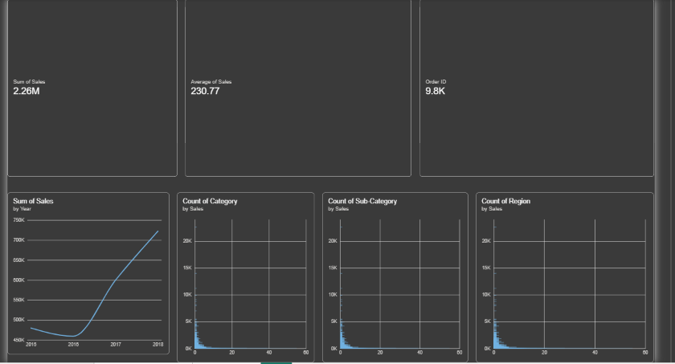
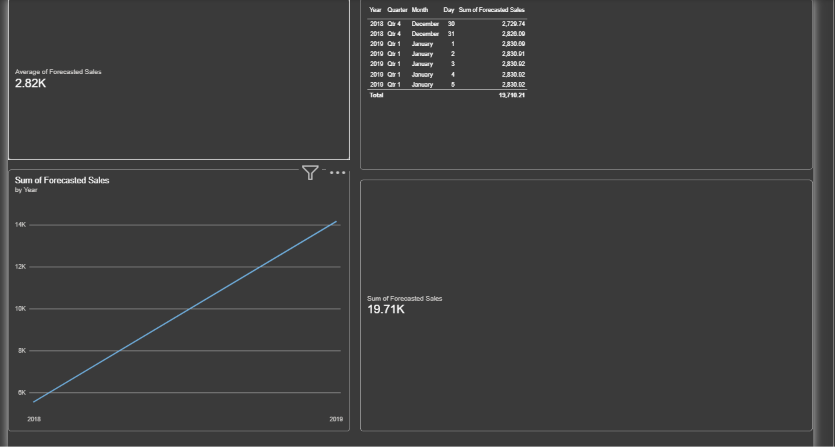

AI‑Enhanced Sales & Revenue Analytics Dashboard
A complete end‑to‑end analytics solution combining Power BI, Python forecasting, and automated insights to help businesses understand sales performance, predict future revenue, and make data‑driven decisions.

This project integrates:

Machine‑learning forecasting (Scikit‑Learn)

DAX‑driven KPIs

Interactive drilldowns

Clean UI/UX with bookmarks

Automated insight cards

📊 Dashboard Features
AI Forecasting (Python)

7‑day revenue prediction

Linear Regression & Random Forest models

Exported forecast results integrated into Power BI

Sales Performance KPIs

YoY, MoM, Variance, Run Rate

Category, Region, Segment breakdowns

Trend analysis with dynamic visuals

Interactive Visuals

Drilldowns by product, region, category

Slicers, bookmarks, navigation buttons

Clean, professional UI/UX

Automated Insights

Anomaly detection

Growth opportunities

High‑impact product categories

🧠 Tech Stack
Power BI (DAX, Data Modeling, Visualisation)

Python (Pandas, NumPy, Scikit‑Learn)

Machine Learning (Regression Forecasting)

CSV Data Integration

Power Query

Project Architecture
ai-enhanced-sales-revenue-analytics-dashboard/
│
├── Sales_Forecast_Dashboard.pbix
├── 7_day_forecast.csv
│
├── screenshots/
│   ├── sales_forecast.png
│   ├── sales_overview.png
│
└── README.md
Python Forecasting Workflow
Load and clean dataset

Feature engineering

Train regression models

Generate 7‑day forecast

Export results to CSV

Load CSV into Power BI

Visualise forecast with KPIs

📈 Power BI Dashboard Workflow
Import dataset + forecast CSV

Build data model

Create KPIs (YoY, MoM, Variance, Run Rate)

Add visuals (line charts, bar charts, maps)

Add drilldowns and slicers

Add bookmarks + navigation

Add automated insight cards

Screenshots

